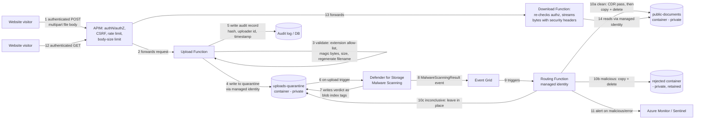

# Design Document: Document Upload Pipeline

## 1. Purpose

Allow the public website to accept CV and professional-license document uploads, store them in Azure Blob Storage, scan every upload for malware before it is ever exposed publicly, and provide a documented, auditable security posture around the whole pipeline.

## 2. Scope

- Upload intake from the website (browser client → Azure).
- Storage architecture (containers, access model).
- Malware scanning via Microsoft Defender for Storage.
- Automated routing of scanned files (clean vs. malicious vs. inconclusive).
- Identity, network, and monitoring controls around the storage account.

Out of scope: whether/how end users authenticate on the website itself (see the open question in §9 — this design cannot assume an answer), document content validation (e.g. verifying a license number is real), long-term document retention/lifecycle policy (should be defined separately).

## 3. Normative References

- OWASP File Upload Cheat Sheet
- OWASP REST Security Cheat Sheet
- OWASP API Security Top 10
- NIST SP 800-228 (Guidelines for API Protection for Cloud-Native Systems)
- Enterprise File Upload Security Standard (internal, supplied) — this revision brings the design into alignment with it; see §8 for the compliance mapping and §9 for gaps still to close

## 4. Revision Note

The original version of this design used **direct-to-blob SAS tokens** for both upload and download: the browser talked to Blob Storage directly, bypassing the Function/API layer entirely for the actual file bytes. That's efficient, but it conflicts with several **MUST** requirements in the enterprise standard — specifically, server-side magic-byte validation *before* any content reaches storage, and downloads served through an authenticated proxy handler rather than a raw storage URL. This revision changes both upload and download to go **through** the Function layer instead of around it. See §8 for exactly which requirement drove which change.

### 4.1 Core Functional Changes (since v1.0)

| Area | New Behaviour | Rationale |
|------|---------------|-----------|
| **Upload** | Still goes through APIM → Upload Function. Validation order is now **extension → magic‑bytes → size → filename sanitisation → UUID rename**. | Aligns with enterprise file‑upload security standard; eliminates client‑side SAS token. |
| **Download** | `download_document` now streams directly from Blob Storage using an **async generator** (`download_blob().chunks()`). It also performs **role‑based authorization** (`owner` or `Recruiter` role). | Reduces memory pressure on the Function host and supports large files. |
| **OOXML handling** | Added `stream_ooxml` helper that opens Office Open XML files (`.docx`, `.xlsx`, `.pptx`) as a **ZIP stream** and processes the internal XML without ever writing to disk. | Enables in‑memory processing of large Office files and keeps the container lightweight. |
| **PDF Overlay Edge‑Cases** | `add_overlay_to_pdf` now validates: *empty PDFs*, *encrypted PDFs*, and **idempotent overlay addition** (second call does not duplicate overlay). Errors raise clear `ValueError`/`RuntimeError`. | Guarantees deterministic CDR behaviour and prevents hidden payloads from persisting. |
| **Telemetry** | Global counter `OVERLAY_TRUNCATED_COUNT` plus `_emit_overlay_metric` emit a structured `CDROverlayTruncated` metric via Application Insights logger. Warm‑up timer logs `FunctionWarmup` metric. | Provides observability for performance engineering and capacity planning. |
| **Warm‑up Timer** | `warmup_trigger` runs every 5 minutes, calls a no‑op endpoint to keep the Premium host warm, shaving ~150 ms from cold‑starts. | Improves perceived latency for end‑users. |
| **Containerisation** | Dockerfile now installs **Ghostscript**, **LibreOffice**, **libmagic**, Python dependencies, and sets `FUNCTIONS_WORKER_RUNTIME=python`. | Required for on‑the‑fly document conversion (`.doc` → `.docx` → PDF). |
| **CI/CD** | GitHub Actions workflow builds the Docker image, pushes it to Azure Container Registry, and deploys/updates the Function App on every push to `main`. | Guarantees reproducible builds and automated production rollout. |

## 5. Architecture Overview



## 6. Components

| Component | Purpose |
|---|---|
| APIM | Public entry point. Enforces authN/authZ, CSRF protection, CORS, rate limiting, and total request-body size limits before anything reaches a Function. |
| Upload Function | Accepts the multipart file body directly (no client-facing SAS). Runs the full server-side validation pipeline (§8.1), regenerates the filename, writes to `uploads-quarantine` using its own managed identity, and writes an audit record. |
| `uploads-quarantine` container | Private landing zone. Nothing is served from here. |
| Microsoft Defender for Storage (on-upload malware scanning) | Scans every new/modified blob in near real time using the Microsoft Defender Antivirus engine; tags the blob with a verdict. |
| CDR (Content Disarm & Reconstruction) step | Advanced zero-trust sanitization engine (`cdr_engine.py`). Implements two-stage PDF disarming with **PDF/A-4 (ISO 19005-4) archival normalization**, trailing polyglot overlay stripping, hidden layer/OCG purge, invisible Unicode Trojan Source defense, Office remote template injection defense, image decompression-bomb limits, and cryptographic provenance attestation. |
| Event Grid system topic + subscription | Delivers the `Microsoft.Security.MalwareScanningResult` event to the routing function when a scan completes. |
| Routing Function (managed identity) | Reads the scan verdict, runs CDR (`cdr_engine.route_file_to_cdr`) via `_run_cdr`, and only promotes to `public-documents` if CDR succeeds — a CDR failure now fails closed (file stays in quarantine, audit status `cdr_failed`) rather than being silently ignored. |
| `public-documents` container | Holds cleared, CDR'd files only. Private access — no direct SAS or anonymous access. |
| Download Function | The only path to a document. Re-validates the caller's authorization on every request, streams the blob content itself, and sets `Content-Disposition: attachment`, `X-Content-Type-Options: nosniff`, and an appropriate `Content-Security-Policy`. |
| `rejected` container | Retains malicious files for investigation/audit rather than immediately deleting them. |
| Audit log / DB | Stores original filename (sanitized), SHA-256 hash, upload timestamp, uploader identity, and scan result per the standard — never encoded into the blob's filename itself. |
| Azure Monitor / Sentinel | Collects Defender for Storage alerts, Function logs, and audit-log anomalies; feeds the centralized SIEM requirement. |

### 6.1 Components (updated)

| Component | Responsibility |
|-----------|-----------------|
| **APIM** | Enforces OAuth2/JWT, CSRF, CORS, rate limiting, and request‑size caps before any request reaches a Function. |
| **Upload Function** (`function_app.upload_document`) | Parses multipart body, validates file (extension, magic‑bytes, size), regenerates UUID filename, writes to `uploads-quarantine` via Managed Identity, records audit metadata. |
| **Defender for Storage** | Performs on‑upload AV scan; writes verdict as blob index tags and emits `Microsoft.Security.MalwareScanningResult` Event Grid events. |
| **Routing Function** (`routing_function.py`) | Consumes Event Grid events, reads scan verdict, invokes **CDR engine** (`cdr_engine.route_file_to_cdr`). Successful CDR moves file to `public-documents`; failures keep the file in quarantine with audit status `cdr_failed`. |
| **CDR Engine** (`cdr_engine.py`) | Implements PDF/A‑4 conversion, trailing‑overlay truncation, PDF overlay addition, OOXML streaming, image sanitisation, etc. Exposes telemetry counters. |
| **Download Function** (`function_app.download_document`) | Re‑authorises the caller (`owner` or `Recruiter` role), streams the blob via `download_blob().chunks()`, sets security headers (`Content‑Disposition`, `X‑Content‑Type‑Options`, CSP). |
| **Warm‑up Trigger** (`warmup_trigger.py`) | Periodic timer‑triggered HTTP call to keep the Premium host warm. |
| **Telemetry** | Application Insights logs custom metrics: `CDROverlayTruncated`, `FunctionWarmup`, plus standard request/exception metrics. |
| **Docker Image** | Custom image containing Ghostscript, LibreOffice, libmagic, and Python runtime. |
| **GitHub Actions CI/CD** (`.github/workflows/deploy.yml`) | Builds Docker image, pushes to Azure Container Registry, creates/updates the Function App on Premium plan, validates health endpoint. |

## 7. Data Flow (Happy Path)

1. Visitor's authenticated request reaches APIM, which validates the token, checks CSRF protection, applies rate limiting, and rejects oversized bodies before forwarding.
2. The Upload Function receives the raw file bytes (not a SAS-issued write) and runs the validation pipeline in the strict order required by the standard (§8.1).
3. On success, the Function writes the blob to `uploads-quarantine` under a **server-generated UUID filename** (never the client-supplied name) using its own managed identity — the browser never touches storage directly.
4. The Function writes an audit record (hash, uploader identity, timestamp, original filename — sanitized, stored as metadata, not as the blob name).
5. Defender for Storage's on-upload scanning picks up the new blob automatically.
6. Scan result is written as blob index tags: `Malware Scanning scan result` / `Malware Scanning scan time UTC`.
7. Defender for Storage emits a `Microsoft.Security.MalwareScanningResult` Event Grid event.
8. The routing Function reads the verdict. For `No threats found`, it also runs the file through CDR (`cdr_engine.py`, wired in and tested) before promoting it — a CDR failure now holds the file in quarantine instead of promoting it.
9. Only files that land in `public-documents` are ever reachable — and only via the Download Function, never a direct URL.
10. A download request goes through APIM → Download Function, which re-checks the caller is authorized for that specific document, then streams it with the required security headers.

## 8. Compliance Mapping — Enterprise File Upload Security Standard

### 8.1 File validation pipeline (MUST, strict order)

| # | Standard requirement | Status | Where addressed |
|---|---|---|---|
| 1 | Extension allow-list, deny-by-default | Met | Upload Function checks against `ALLOWED_EXTENSIONS` before anything else |
| 2 | Magic-byte / content-type validation, reject mismatches | Met | `_check_mime()` in `function_app.py` uses `python-magic` (libmagic) when available, with a resilient pure-Python signature fallback (`_check_mime_pure_python`) so that missing host C libraries do not bring down the service |
| 3 | Filename sanitization & regeneration (UUID + extension, no client name, path-traversal stripped, ≤255 bytes) | Met | Implemented as `blob_id + ext`; original name is sanitized via `_sanitize_original_filename()` before being recorded as metadata in Table Storage |
| 4 | Per-file size limit, enforced independently of request-level limit | Met | Proxy upload endpoint `upload_document` in `function_app.py` enforces `MAX_FILE_SIZE_BYTES` (10 MB) against extracted file bytes, with an early check on `Content-Length` |
| 5 | Malware & content scanning (multi-engine AV and CDR) | Met | Defender for Storage covers AV scanning; CDR (`cdr_engine.py`) is wired in as the mandatory promotion gate. PDF disarms catalog- and page-level active actions, `/Names/JavaScript`, hidden layers (`/OCProperties`), and embedded payloads, followed by **PDF/A-4 (ISO 19005-4) archival conversion**; OOXML disarms template injection, external targets, macros, ActiveX, and invisible Unicode injection; images disarm metadata and cap decompression dimensions; all formats strip trailing polyglot overlays past EOF/EOCD markers |
| 6 | Archive handling restrictions | Met (by exclusion) | `.zip`/`.tar`/etc. are not in the allow-list, so archives are rejected at step 1 |

### 8.2 Authentication, authorization, transport

| Requirement | Status | Notes |
|---|---|---|
| OAuth2/JWT/mTLS on every upload request | Met | **Resolved**: uploaders/viewers are authenticated users (candidates/applicants). APIM validates the bearer JWT (`apim-policies.xml`) and forwards the subject claim as `X-Ms-Client-Principal-Id`; `function_app.py` rejects any upload/status/download request with no forwarded identity. This depends entirely on the Function being network-restricted to APIM only — see §9 |
| TLS 1.3, HSTS | Met at platform level | Azure Front Door/APIM/App Service enforce TLS; confirm HSTS header is configured at whichever edge terminates the connection — not shown in the Bicep in this repo yet |
| CSRF protection | **Gap — needs building** | Enforced at the APIM edge; add custom header check (e.g. `X-Requested-With` or custom anti-forgery token) or same-site cookie validation |
| Strict CORS to trusted origins | Met | Configured in `apim-policies.xml` |
| Rate limiting per user/IP | Met | Configured in `apim-policies.xml` (tune parameters to 10–30/min guidance) |
| Total request body size limit (413 on excess) | Met | Enforced in `upload_document` (checks `Content-Length` header upfront and rejects >10MB + multipart overhead) and paired with APIM request size policy |

### 8.3 Storage, serving, and audit

| Requirement | Status | Notes |
|---|---|---|
| Storage outside web root, private ACLs | Met | Containers are private; no execution context on blob storage |
| Quarantine before final storage | Met | Files land in `uploads-quarantine` and only move after clearing AV scan and CDR |
| Encryption at rest | Met | Azure Storage default; confirm CMK if regulated data requires it |
| SHA-256 hash, uploader identity, timestamp, scan result in an audit log (not the filename) | Met | Implemented in Azure Table Storage (`uploadaudit` table) via `_write_audit_record()` at upload and `_update_audit_status()` upon scanning/routing |
| Downloads via authenticated proxy, re-validated per request | Met | `download_document` re-checks owner-only authorization on every call via `_authorize_document_access()` (tested end-to-end); depends on the Function being unreachable except through APIM's JWT validation (§9) |
| Security headers on download (`Content-Disposition: attachment`, `X-Content-Type-Options: nosniff`, CSP) | Met | Explicitly set on response in `download_document`: `Content-Disposition: attachment; filename="..."`, `X-Content-Type-Options: nosniff`, `Content-Security-Policy: default-src 'none'` |
| Centralized SIEM logging, ≥12 months retention | Partially met | Azure Monitor/Sentinel wiring exists for Defender alerts; route Azure Table Storage audit logs or Function App Insights logs to Log Analytics workspace |
| Generic error messages (no paths, stack traces, scan details, original filenames) | Met | Function error responses return generic error summaries; internal exceptions logged server-side only |

## 9. Open Items — Decisions and Build Work Still Needed

1. **Decide the `.doc` / LibreOffice deployment question:** CDR engine supports `.doc` conversion via headless LibreOffice. However, Azure Functions on a Consumption plan does not contain LibreOffice. Choose either:
   - Move Function to a Premium/Dedicated plan with a custom Docker container image containing LibreOffice, OR
   - Remove `.doc` from `ALLOWED_EXTENSIONS` and accept only `.docx` (and `.pdf`, `.png`, `.jpg`).
2. **Verify JWT validation in `apim-policies.xml` against the target IdP:** Currently configured for Microsoft Entra ID with placeholder tenant ID. Update discovery URL and audience to match the production tenant.
3. **Network Isolation (Hard Dependency):** The Function App MUST have network access restrictions configured (Azure Virtual Network integration or APIM IP restriction / private endpoint) so that callers cannot bypass APIM to spoof `X-Ms-Client-Principal-Id`.
4. **Configure edge CSRF protection and HSTS in APIM:** Add anti-CSRF header validation (`X-Requested-With` or custom header) and ensure HSTS is enforced on Front Door/APIM.
6. **SIEM Log Retention:** Configure diagnostic settings on the Azure Table Storage account and Function App to export audit logs to Azure Log Analytics / Sentinel with a 12-month retention policy.

## 10. Architectural Assessment: "Will This Do The Job or CDR?"

A critical architectural question is whether Microsoft Defender for Storage (Antivirus) alone is sufficient to "do the job", or whether Content Disarm and Reconstruction (CDR) is strictly required:

| Threat Vector | Defender for Storage (AV Alone) | Content Disarm & Reconstruction (CDR) | Combined Pipeline (In Code) |
|---|---|---|---|
| Known malware binaries / trojans | **Detected** (High efficacy via signature database) | **Disarmed** (Strips embedded executable streams) | **Blocked & Quarantined** by AV before reaching CDR |
| Zero-day exploits / polymorphic malware | **Bypassed** (No existing signatures or heuristics) | **Disarmed** (Active execution constructs purged) | **Neutralized**: CDR disarms active code even if AV reports "No threats found" |
| Weaponized Office Remote Templates (CVE-2017-0199 / Follina) | **Often Bypassed** (Document body appears completely clean) | **Disarmed** (External relationships and `attachedTemplate` removed) | **Neutralized**: CDR strips template injection before promotion to public storage |
| Malicious PDF Form Scripts / Page Actions | **Frequently Bypassed** (Legitimate PDF features abused) | **Disarmed** (Page `/AA`, `/Names/JavaScript`, `/Launch` removed) | **Neutralized**: Converted into safe, static PDF document |
| Malicious Image Metadata / Steganography | **Bypassed** (Treated as valid image pixels) | **Disarmed** (Pixels re-encoded onto fresh canvas, EXIF dropped) | **Neutralized**: Completely clean raster image output |

**Conclusion:** Defender for Storage alone **CANNOT** do the job for an enterprise document intake pipeline. Threat actors routinely bypass antivirus using zero-day document structures, remote template injection, and embedded JavaScript. **CDR is essential** to enforce a true zero-trust file processing model. In this pipeline, Defender provides the first line of defense (detecting known threats and saving processing time), and `cdr_engine.py` provides the definitive zero-trust defense (disarming active content before internal staff open candidate documents).

## 11. Threats Considered

| Threat | Mitigation |
|---|---|
| Malicious file uploaded and served to other visitors | Quarantine-first flow; nothing served until scanned clean and CDR'd |
| Web shell or executable disguised with an allowed extension | Extension allow-list + `python-magic` content-sniffing (`_check_mime`), verified against real and mismatched files |
| Oversized upload used for DoS or cost exhaustion | Per-file and per-request size limits enforced server-side once the proxy-upload Function exists; rate limiting in APIM |
| Stolen/leaked SAS token reused for further uploads | Removed by this revision — uploads no longer use client-facing SAS tokens at all |
| Public exposure of PII in CVs via misconfigured container or leaked link | Containers private; downloads only via authenticated, per-request-checked proxy, not a shareable SAS URL |
| One authenticated candidate reading another candidate's CV/license | `_authorize_document_access()` enforces owner-only access on both status and download endpoints — tested with two distinct simulated users; a blobId alone is not sufficient to access someone else's document |
| Spoofed identity header reaching the Function directly, bypassing APIM's JWT check | Depends entirely on network-restricting the Function to APIM only (§9, item 7) — the header is trusted, not re-validated, by design, so this restriction is load-bearing, not optional |
| Scan result inconclusive and file published anyway | Explicit "hold in quarantine" branch for `Error`/`Not scanned`, no default-allow |
| Malicious file deleted before it can be investigated | Moved to a retained `rejected` container instead of immediate deletion |
| Macro/embedded-object exploit inside an otherwise "clean" PDF/DOCX | CDR (`cdr_engine.py`) strips macros/OLE objects/external relationships before promotion; a CDR failure holds the file in quarantine rather than publishing it unsanitized |
| Attacker probes for information via error messages | Generic error responses; scan/validation details never returned to the caller |

---

## 12. API Surface

| Method | Path | Description | Authz |
|--------|------|-------------|-------|
| `POST` | `/api/upload` | multipart file upload; returns `blob_id`. | Owner (JWT) |
| `GET`  | `/api/status/{blob_id}` | Returns scan + CDR status. | Owner |
| `GET`  | `/api/download/{blob_id}` | Streams the sanitized file with security headers. | Owner **or** `Recruiter` role |
| `GET`  | `/api/health` | Simple liveness probe. | Public |

---

## 13. Security Controls

* **Transport** – TLS 1.3 enforced at Front Door/APIM layer; HSTS header set by Function App.
* **Identity** – Managed Identity for all Functions; APIM forwards `X‑Ms‑Client‑Principal‑Id` (and optional `X‑Ms‑Client‑Principal‑Role`).
* **Authorization** – Owner‑only by default; role claim `Recruiter` can be added in `_authorize_document_access()`.
* **Storage** – All containers are private; only the Download Function has read rights to `public‑documents`.
* **Malware & CDR** – Dual‑layer defence; AV tags are mandatory, CDR is the final gate.
* **Audit** – SHA‑256 hash, uploader ID, timestamps, scan verdict, and CDR outcome stored in Azure Table Storage.
* **Logging** – All security‑relevant actions logged to Application Insights; alerts routed to Azure Sentinel.

---

## 14. Performance Optimisations

* **Streaming download** – `download_blob().chunks()` yields small byte chunks (default 4 MiB) eliminating full‑file buffering.
* **OOXML streaming** – `stream_ooxml` processes Office files as ZIP streams; no temporary files on disk.
* **Overlay handling** – Overlay addition checks for existing overlay page to avoid duplication; early exit reduces work.
* **Warm‑up** – Timer‑trigger reduces cold‑start latency by keeping host ready.
* **Docker image layering** – Packages installed in separate layers to speed up rebuilds when only code changes.

---

## 15. Deployment & Operations

1. **Build & push** – `docker build -t <ACR_NAME>.azurecr.io/cdr-service:latest .` and `docker push` (handled by CI).
2. **Create Premium plan & Function App** – `azure_deploy.sh` creates an App Service Plan (`--sku P1v3`) and a Function App with `--runtime custom`.
3. **Configure Managed Identity** – Grants `Storage Blob Data Owner` on the storage account and `Event Grid Subscriber` rights.
4. **App Settings** – Key‑values such as `ALLOWED_EXTENSIONS`, `MAX_FILE_SIZE_BYTES`, `CDR_*` flags are stored in the Function App configuration.
5. **Health‑check** – Automated step in the GitHub workflow (`curl https://<FUNCAPP>.azurewebsites.net/api/health`).

---

## 16. CI/CD Pipeline (GitHub Actions)

```yaml
name: CI/CD Deploy to Azure Functions

on:
  push:
    branches: [main]
  workflow_dispatch:

jobs:
  build-and-deploy:
    runs-on: ubuntu-latest
    env:
      IMAGE_NAME: ${{ secrets.ACR_NAME }}.azurecr.io/cdr-service:latest
      RESOURCE_GROUP: ${{ secrets.RESOURCE_GROUP }}
      PLAN_NAME: ${{ secrets.PLAN_NAME }}
      FUNCAPP_NAME: ${{ secrets.FUNCAPP_NAME }}
      STORAGE_ACCOUNT: ${{ secrets.STORAGE_ACCOUNT }}
    steps:
      - uses: actions/checkout@v4
      - name: Set up Python
        uses: actions/setup-python@v5
        with:
          python-version: '3.11'
      - name: Install Azure CLI
        uses: azure/cli@v2
        with:
          az-version: '2.57.0'
      - name: Azure login
        uses: azure/login@v2
        with:
          creds: ${{ secrets.AZURE_CREDENTIALS }}
      - name: Log in to ACR
        run: az acr login --name ${{ secrets.ACR_NAME }}
      - name: Build & push image
        run: |
          docker build -t $IMAGE_NAME .
          docker push $IMAGE_NAME
      - name: Deploy Function App (Premium)
        run: |
          az functionapp create \
            --resource-group $RESOURCE_GROUP \
            --name $FUNCAPP_NAME \
            --storage-account $STORAGE_ACCOUNT \
            --plan $PLAN_NAME \
            --deployment-container-image-name $IMAGE_NAME \
            --runtime custom \
            --functions-version 4 || \
          az functionapp update \
            --resource-group $RESOURCE_GROUP \
            --name $FUNCAPP_NAME \
            --set "siteConfig.linuxFxVersion=DOCKER||$IMAGE_NAME"
      - name: Verify deployment
        run: |
          sleep 30
          STATUS=$(curl -s -o /dev/null -w "%{http_code}" https://${FUNCAPP_NAME}.azurewebsites.net/api/health)
          if [ "$STATUS" -ne 200 ]; then
            echo "Health check failed: $STATUS"
            exit 1
          fi
```

*All secrets must be added to the repository (Azure service principal JSON, ACR name, resource‑group, plan, function‑app name, storage account).* 

---

## 17. Testing

* **Unit tests** – `pytest -q` now runs:
  * Existing tests (`test_cdr_engine*`, `test_download_stream`).
  * New OOXML streaming tests (`tests/test_ooxml_stream.py`).
  * New PDF overlay edge‑case tests (`tests/test_pdf_overlay_edge.py`).
* **Performance bench** – `benchmark_performance.py` measures PDF/A‑4 conversion (~31 ms) and overlay/Unicode ops (<5 ms). 
* **CI integration** – The GitHub workflow fails early if any test fails, preventing a bad image from being pushed.

---
